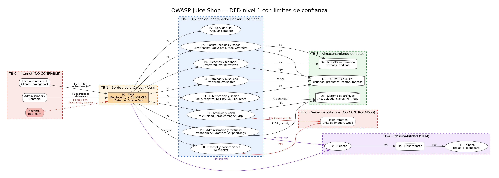

# Hito 1 · Diseño seguro

Copien esta carpeta a `docs/hito-1/` del repositorio de su aplicación y
completen cada sección. Borren las líneas que empiezan con *Instrucción*.

Integrantes y roles:

| Nombre | Rol |
|---|---|
| Andre Jo | Equipo rojo |
| Pedro Guzman | Equipo rojo |
| Isabella Miralles    | Equipo azul |
| Edwin Andres Ortega Kou | Equipo azul |

## DFD

<!--
*Instrucción: diagrama de flujo de datos de su aplicación, con los límites de
confianza marcados. Guarden la imagen en esta carpeta, por ejemplo como
`dfd.png`, y péguenla debajo.*
-->



## STRIDE

*Instrucción: una amenaza por letra. El componente es de su app, no un ejemplo
genérico.*

## STRIDE

*Instrucción: una amenaza por letra. El componente es de su app, no un ejemplo
genérico.*

| Letra | Amenaza | Componente | Control |
|---|---|---|---|
| Suplantación | Pasar como administrador sin conocer su contraseña, utilizando inyecciones SQL hacia el login o tomando el token JWT para hacer consultas. | Proceso 3 - Autenticación | Realizar consultas parametrizadas con Sequelize. Validar el formato del correo, verificar que la firma y el algoritmo del JWT sean correctos. Aplicar reglas en el WAF para SQL injection. |
| Manipulación | Modificar la información, por ejemplo reseñas. En Juice Shop se observa que no se necesita autenticación para editar una reseña. | Proceso 6 - Reseñas | Implementar autorización en la ruta y comprobar que el token sea del usuario que escribió la reseña. |
| Repudio | El usuario actúa y luego lo niega, porque los registros son incompletos o se pueden borrar o alterar. | Proceso 9 - Administración y logs | Logs de auditoría con usuario, IP y hora. |
| Divulgación de información | Se descargan archivos confidenciales que se extraen por medio de `/ftp`. | Proceso 7 - Subida de archivos | Límite de tamaño y desactivar entidades XML externas. Configurar reglas de ráfagas en el WAF. |
| Elevación de privilegios | Un usuario se puede registrar como administrador si cambia el rol a administrador. | Proceso 3 - Registro | Ignorar el campo `role` en el servidor y asignarlo siempre como "customer". |

## PASTA

*Instrucción: etapas 1 a 5. La etapa 5 reutiliza los hallazgos del Proyecto
DAST. Las etapas 6 y 7 se cierran en el Hito 2 y en el informe.*

### Etapa 1 · Objetivos del negocio
Es una tienda en línea de jugos que permite registrarse, buscar productos, armar un carrito, pagar, dejar reseñas y contactar al soporte. Para este proyecto se trata como si fuera una tienda real en producción.

Sus principales objetivos son los siguientes

| ID | Objetivo | Impacto si hay una vulnerabilidad |
|---|---|---|
| OB-1 | Vender en línea con alta disponibilidad | Un ataque de denegación de servicio detiene las ventas y causa pérdida directa de ingresos |
| OB-2 | Proteger los datos de los clientes (credenciales, direcciones, tarjetas, pedidos) | Una inyección SQL o un acceso indebido filtra datos personales y de pago, con daño al cliente y responsabilidad legal |
| OB-3 | Evitar el fraude en pagos, cupones y cuentas | Un atacante obtiene productos gratis, abusa de cupones o toma cuentas ajenas |
| OB-4 | Mantener la confianza y la reputación de la marca | Reseñas manipuladas o redirecciones a sitios maliciosos hacen perder la confianza de los clientes |
| OB-5 | Cumplir con la protección de datos personales | Una filtración o un borrado de datos mal controlado expone a sanciones y a reclamos de los usuarios |


**Activos críticos**


| Activo | Impacto si hay una vulnerabilidad |
|---|---|
| Cuentas y credenciales de usuarios | Suplantación de identidad, compras fraudulentas y acceso a datos personales |
| Datos de pago y direcciones | Fraude financiero y filtración de información sensible del cliente |
| Cuentas administrativas | Control total de la tienda: usuarios, productos, pedidos y configuración |
| Catálogo y precios | Alteración de precios o productos, con pérdidas económicas |
| Reseñas y feedback | Contenido falso o modificado que daña la reputación de la marca |
| Claves y secretos (JWT, archivos del servidor) | Falsificación de sesiones y acceso a cualquier cuenta |
| Logs | Pérdida de evidencia: los ataques no se detectan ni se pueden atribuir |


**Impacto de un ataque exitoso**

| Tipo | Impacto |
|---|---|
| Económico | Fraude con cupones y pagos, pérdida de ventas por caída del servicio |
| Datos | Filtración de información personal y de pago de los clientes |
| Reputación | Pérdida de confianza si hay reseñas manipuladas o cuentas tomadas |
| Legal | Sanciones por no proteger los datos personales |


**Requisitos de seguridad derivados**

| ID | Requisito | Objetivo | Verificación |
|---|---|---|---|
| RS-01 | Toda consulta a la base de datos es parametrizada; ninguna entrada del usuario se concatena en SQL. | OB-2 | SAST + pruebas de inyección |
| RS-02 | Toda ruta que modifique datos exige autenticación y comprueba que el recurso pertenece al usuario. | OB-2, OB-4 | Pruebas de autorización |
| RS-03 | El rol de un usuario nunca se acepta desde la petición del cliente. | OB-3 | Intento de registro con `role: admin` |
| RS-04 | Los JWT se validan siempre (firma, algoritmo y expiración) y no contienen datos sensibles. | OB-2 | Prueba con token alterado; revisión del payload |
| RS-05 | Los archivos internos, logs y configuración no se publican ni se listan. | OB-2 | Acceso a `/ftp`, `/support/logs` y `/rest/admin/*` |
| RS-06 | La subida de archivos tiene límites de tamaño y bloquea entidades XML externas. | OB-1 | Subida de archivo malicioso |
| RS-07 | Las acciones sensibles se registran con usuario, IP y hora, y los logs salen a un SIEM. | OB-3, OB-5 | Consulta en Kibana |
| RS-08 | Los intentos de ataque (SQLi, XSS, ráfagas) se detectan y se bloquean en el WAF. | OB-1, OB-2 | Repetición de PoC con WAF en modo On |
| RS-09 | Las redirecciones solo van a destinos de una lista exacta de permitidos. | OB-4 | Prueba de `/redirect?to=` con dominios externos |
| RS-10 | Las operaciones que cambian estado exigen protección anti-CSRF. | OB-3 | Prueba de envío cruzado a `/dataerasure` |

### Etapa 2 · Alcance técnico

**Dentro del alcance**

| Elemento | Detalle |
|---|---|
| Instancia evaluada | Juice Shop local del grupo, en `http://localhost:8080` (detrás del WAF) |
| Frontend | Aplicación Angular (SPA) |
| Backend | Node.js + Express (TypeScript): API REST (`/rest/*`, `/api/*`, `/b2b/v2/*`) y rutas de archivos (`/ftp`, `/support/logs`) |
| Tiempo real | WebSocket con socket.io (chatbot y notificaciones) |
| Datos | SQLite (Sequelize) y almacén en memoria (MarsDB) |
| Archivos del servidor | `/ftp`, subidas de usuarios, claves JWT y logs |
| Defensa y monitoreo | WAF (ModSecurity + OWASP CRS), Filebeat, Elasticsearch y Kibana |
| Pipeline | GitHub Actions: SAST, SCA, SBOM (CycloneDX con Syft) y DAST (ZAP) |


**Fuera del alcance**

| Elemento | Motivo |
|---|---|
| Juice Shop público (herokuapp) | Prohibido por las reglas de enfrentamiento |
| Recursos de la Universidad y de terceros | Prohibido; incluye GitHub, CDN y servicios de imágenes externos |
| Servicios externos reales (web3, hosts remotos) | No están bajo nuestro control; solo se evalúa cómo la app interactúa con ellos |
| Infraestructura del equipo (laptops, red local) | No es parte del sistema evaluado |


**Tecnologías y componentes**

| Capa | Tecnología | Función |
|---|---|---|
| Presentación | Angular | Interfaz de la tienda |
| Lógica de negocio | Node.js, Express, TypeScript | API, reglas de negocio y autenticación |
| Autenticación | JWT (RS256), 2FA | Sesiones y segundo factor |
| Persistencia | SQLite (Sequelize), MarsDB | Usuarios, productos, cestas, reseñas y pedidos |
| Comunicación en tiempo real | socket.io | Chatbot y notificaciones |
| Empaquetado | Docker / Docker Compose | Ejecución local del entorno |
| Borde | ModSecurity + OWASP CRS | Filtrado y bloqueo de ataques web |
| SIEM | Filebeat, Elasticsearch, Kibana | Recolección, análisis y dashboard de logs |


**Grupos de rutas principales**

| Grupo | Ejemplos |
|---|---|
| Autenticación y cuenta | `/rest/user/login`, `/api/Users`, `/rest/2fa/*`, `/dataerasure` |
| Catálogo | `/rest/products/search`, `/api/Products` |
| Carrito y pagos | `/rest/basket/:id`, `/api/Cards`, `/b2b/v2/orders` |
| Reseñas y feedback | `/rest/products/:id/reviews`, `/api/Feedbacks` |
| Archivos | `/file-upload`, `/profile/image/*`, `/ftp` |
| Administración y monitoreo | `/rest/admin/*`, `/metrics`, `/support/logs` |
| Otros | `/redirect`, `/socket.io/` |


**Herramientas de evaluación**

| Fase | Herramienta |
|---|---|
| DAST | ZAP 2.17.0 |
| SAST | Semgrep o SonarQube Cloud (Hito 2) |
| SCA | npm audit o Trivy (Hito 2) |


### Etapa 3 · Descomposición de la aplicación


**Entidades externas (actores)**

| Actor | Descripción | Nivel de confianza |
|---|---|---|
| Usuario anónimo | Visitante sin sesión: navega, busca y se registra | Ninguno |
| Cliente autenticado | Usuario con sesión: compra, deja reseñas y administra su cuenta | Bajo |
| Administrador / contable | Usuario con rol privilegiado: gestiona pedidos y configuración | Alto |
| Atacante / Red Team | Actor hostil que envía payloads y escanea | Ninguno |

**Procesos**

| ID | Proceso | Función | Rutas principales |
|---|---|---|---|
| P1 | WAF (ModSecurity + CRS) | Filtra y bloquea el tráfico malicioso antes de llegar a la app | Todo el tráfico entrante |
| P2 | Servidor de la SPA | Entrega la interfaz Angular | Archivos estáticos, `/redirect` |
| P3 | Autenticación y sesión | Registro, login, JWT, 2FA, cambio y recuperación de contraseña | `/rest/user/login`, `/api/Users`, `/rest/2fa/*`, `/dataerasure` |
| P4 | Catálogo y búsqueda | Lista y busca productos | `/rest/products/search` |
| P5 | Carrito, pedidos y pagos | Cestas, tarjetas, direcciones y órdenes | `/rest/basket/:id`, `/api/Cards`, `/b2b/v2/orders` |
| P6 | Reseñas y feedback | Opiniones de productos y comentarios al soporte | `/rest/products/:id/reviews`, `/api/Feedbacks` |
| P7 | Archivos y perfil | Subida de archivos, imagen de perfil y carpeta pública | `/file-upload`, `/profile/image/*`, `/ftp` |
| P8 | Chatbot y notificaciones | Comunicación en tiempo real | `/socket.io/` |
| P9 | Administración y métricas | Configuración, métricas y logs | `/rest/admin/*`, `/metrics`, `/support/logs` |
| P10 | Filebeat | Recolecta y envía los logs | Logs del WAF y de la app |
| P11 | Kibana | Reglas de detección y dashboard | Consultas sobre Elasticsearch |

**Almacenes de datos**

| ID | Almacén | Datos que guarda | Sensibilidad |
|---|---|---|---|
| D1 | SQLite (Sequelize) | Usuarios, hashes de contraseña, productos, cestas, tarjetas, feedback | Alta |
| D2 | MarsDB (en memoria) | Reseñas y pedidos | Media |
| D3 | Sistema de archivos | `/ftp`, imágenes subidas, claves JWT y logs | Alta |
| D4 | Elasticsearch | Eventos y logs del WAF y de la app | Media |

**Límites de confianza**

| ID | Límite | Qué separa | Riesgo principal |
|---|---|---|---|
| TB-0 → TB-1 | Internet ↔ WAF | Clientes no confiables del resto del sistema | Toda entrada es hostil por defecto |
| TB-1 → TB-2 | WAF ↔ Aplicación | Tráfico filtrado de la lógica de negocio | Evasión del WAF; no sustituye la validación en código |
| TB-2 → TB-3 | Aplicación ↔ Datos | Lógica de negocio de la persistencia | Inyección SQL, acceso indebido a archivos y secretos |
| TB-2 → TB-5 | Aplicación ↔ Externos | La app de hosts que no controlamos | Redirecciones abiertas, descarga de URLs externas |
| TB-1/TB-2 → TB-4 | Aplicación y WAF ↔ SIEM | Generación de logs de su análisis | Integridad y confidencialidad de los logs |

**Flujos de datos que cruzan límites de confianza**

| ID | Origen → Destino | Datos | Límite |
|---|---|---|---|
| F1 | Usuario → WAF | Credenciales, JWT, búsquedas, reseñas, archivos | TB-0 → TB-1 |
| F2 | Administrador → WAF | Operaciones privilegiadas | TB-0 → TB-1 |
| F3 | Atacante → WAF | Payloads maliciosos | TB-0 → TB-1 |
| F4 | WAF → procesos P2 a P9 | Tráfico HTTP y WebSocket filtrado | TB-1 → TB-2 |
| F5 | P3 → D1 | Usuarios, hashes de contraseña | TB-2 → TB-3 |
| F6 | P4 → D1 | Consulta de productos (SQL) | TB-2 → TB-3 |
| F7 | P5 → D1 | Cestas, tarjetas, direcciones | TB-2 → TB-3 |
| F8 | P5 → D2 | Pedidos | TB-2 → TB-3 |
| F9 | P6 → D2 | Reseñas (contenido libre) | TB-2 → TB-3 |
| F10 | P6 → D1 | Feedback | TB-2 → TB-3 |
| F11 | P7 → D3 | Archivos subidos y `/ftp` | TB-2 → TB-3 |
| F12 | P3 → D3 | Clave JWT | TB-2 → TB-3 |
| F13 | P9 → D3 | Logs y configuración | TB-2 → TB-3 |
| F14 | P7 → Externos | Descarga de imagen por URL | TB-2 → TB-5 |
| F15 | P8 → Externos | Consultas del chatbot | TB-2 → TB-5 |
| F16 | P1 → P10 | Logs de auditoría del WAF | TB-1 → TB-4 |
| F17 | Aplicación → P10 | Logs de acceso y de la app | TB-2 → TB-4 |
| F18 | P10 → D4 | Eventos | Dentro de TB-4 |
| F19 | D4 → P11 | Consultas y reglas de detección | Dentro de TB-4 |

### Etapa 4 · Análisis de amenazas

**Actores de amenaza**

| Actor | Motivación | Capacidad | Punto de entrada típico |
|---|---|---|---|
| Atacante externo anónimo | Fraude, robo de datos, daño a la marca | Herramientas automatizadas y pruebas manuales | F1 / F3: tráfico hacia el WAF |
| Cliente malicioso autenticado | Abusar de funciones (reseñas, cestas, cupones) | Conoce la aplicación desde dentro y tiene un token válido | F1: API autenticada |
| Atacante que busca escalar privilegios | Controlar la tienda | Manipula peticiones y roles | F1 / F4: registro y rutas administrativas |

**Amenazas por componente (STRIDE)**

| ID | Letra | Amenaza | Componente | Control |
|---|---|---|---|---|
| T-01 | Suplantación | Pasar como administrador sin conocer su contraseña, utilizando inyecciones SQL hacia el login. | P3 · Autenticación | Consultas parametrizadas con Sequelize. Validar el formato del correo. Reglas en el WAF para SQL injection. |
| T-02 | Suplantación | Tomar el token JWT guardado en `localStorage` (por ejemplo, mediante XSS) para hacer consultas como otro usuario. | P3 · Autenticación (frontend) | Verificar firma y algoritmo del JWT. No guardar datos sensibles en el token. Usar cookie HttpOnly y una CSP estricta. |
| T-03 | Suplantación | Un enlace que usa `/redirect?to=` lleva a la víctima a un sitio falso que imita a la tienda (phishing). | P2 · Ruta `/redirect` | Lista de destinos permitidos con comparación exacta, no con `includes()`. |
| T-04 | Manipulación | Modificar información, por ejemplo reseñas. En Juice Shop no se necesita autenticación para editar una reseña. | P6 · Reseñas | Autorización en la ruta y comprobar que el token sea del usuario que escribió la reseña. |
| T-05 | Manipulación | Un sitio externo fuerza al usuario autenticado a enviar el formulario de `/dataerasure` sin que lo sepa (CSRF). | P3 · Cuenta (`/dataerasure`) | Token anti-CSRF, cookies `SameSite` y restringir CORS a orígenes conocidos. |
| T-06 | Repudio | El usuario actúa y luego lo niega, porque los registros son incompletos o se pueden borrar o alterar. | P9 · Administración y logs | Logs de auditoría con usuario, IP y hora, enviados a Elasticsearch fuera del alcance de la app. |
| T-07 | Divulgación de información | Se descargan archivos confidenciales extraídos por medio de `/ftp`. | P7 · Archivos (`/ftp`) | Quitar el listado de directorios y sacar los archivos sensibles de la carpeta publicada. |
| T-08 | Divulgación de información | Se lee la configuración de la aplicación (`/rest/admin/application-configuration`) y el JWT expone el hash de la contraseña y otros datos del usuario. | P9 · Administración y P3 · Autenticación | Control de rol en las rutas `/rest/admin/*`. Reducir el payload del JWT a lo mínimo (id y rol). |
| T-09 | Denegación de servicio | Subir archivos diseñados para agotar CPU o memoria, o inundar el login con peticiones. | P7 · Subida de archivos y P3 · Login | Límite de tamaño, desactivar entidades XML externas, límite de tasa y reglas de ráfagas en el WAF. |
| T-10 | Elevación de privilegios | Un usuario se registra como administrador si cambia el rol en la petición. | P3 · Registro | Ignorar el campo `role` en el servidor y asignarlo siempre como "customer". |
| T-11 | Elevación de privilegios | Acceder a la cesta o a los datos de otro usuario cambiando el id de la ruta (IDOR). | P5 · Carrito (`/rest/basket/:id`) | Control de acceso por objeto: el id debe pertenecer al usuario del token. |

**Trazabilidad de cada amenaza**

| ID | Flujo | Límite | Requisito | Vulnerabilidad (etapa 5) | Prioridad |
|---|---|---|---|---|---|
| T-01 | F1, F5 | TB-0 → TB-2 → TB-3 | RS-01, RS-08 | V-13 | Alta |
| T-02 | F1 | TB-0 → TB-2 | RS-04 | V-05, V-10 | Alta |
| T-03 | F1 | TB-0 → TB-2 | RS-09 | V-01, V-11 | Media |
| T-04 | F9 | TB-2 → TB-3 | RS-02 | V-12 | Alta |
| T-05 | F1 | TB-0 → TB-2 | RS-10 | V-02, V-03 | Media |
| T-06 | F13, F17 | TB-2 → TB-4 | RS-07 | Por confirmar | Media |
| T-07 | F11 | TB-2 → TB-3 | RS-05 | Por confirmar | Alta |
| T-08 | F13, F5 | TB-2 → TB-3 | RS-04, RS-05 | V-08, V-10 | Media |
| T-09 | F1, F11 | TB-0 → TB-2 | RS-06, RS-08 | Por confirmar | Media |
| T-10 | F1, F5 | TB-0 → TB-2 → TB-3 | RS-03 | V-14 | Alta |
| T-11 | F1, F7 | TB-0 → TB-2 → TB-3 | RS-02 | Por confirmar | Alta |


### Etapa 5 · Vulnerabilidades

| Hallazgo (del DAST) | Dónde está | Relación con el DFD |
|---|---|---|
| **Redirección abierta** (Off-site Redirect, riesgo Alto, CWE-601). El parámetro `to` se refleja en la cabecera `Location` de una respuesta 302. | `GET /redirect?to=https://github.com/juice-shop/juice-shop` | P2 · ruta `/redirect`. Entrada por F1 → F4 (TB-0 → TB-2). Amenaza T-03 (phishing) |
| **Ausencia de tokens anti-CSRF** (riesgo Medio, CWE-352). El formulario no incluye token. | `POST /dataerasure` (formulario en `GET /dataerasure`) | P3 · cuenta. Entrada por F1 → F4 (TB-0 → TB-2). Amenaza T-05 |
| **CORS abierto a cualquier origen** (riesgo Medio, CWE-264). Cabecera `Access-Control-Allow-Origin: *`. | `/`, `/robots.txt`, `/sitemap.xml`, `/assets/public/favicon_js.ico` y archivos JavaScript | Respuestas de la aplicación (P2) hacia el navegador, TB-2 → TB-0. Amenaza T-05 |
| **Content Security Policy no definida** (riesgo Medio, CWE-693). Sin cabecera CSP. | `/`, `/sitemap.xml` y archivos de `/ftp` | P2 y P7. Respuestas hacia TB-0. Amenaza T-02 (robo del JWT vía XSS) |
| **JWT guardado en `localStorage`** (riesgo Medio, CWE-922). | Clave `token` en el navegador, visible desde `/#/search` | P3 · autenticación (lado cliente). Datos de F1. Amenaza T-02 |
| **Identificador de sesión en la URL** (riesgo Medio, CWE-598). Parámetro `sid` expuesto. | `/socket.io/?EIO=4&transport=polling&sid=...` (y la variante `websocket`) | P8 · chatbot y notificaciones. Flujo F4 (WebSocket). Amenaza T-02 |
| **Falta de cabecera anti-clickjacking** (riesgo Medio, CWE-1021). Sin `X-Frame-Options`. | `/socket.io/` | P8. Respuestas hacia TB-0. Amenaza T-05 |
| **Cabecera `X-Content-Type-Options` ausente** (riesgo Bajo, CWE-693). | `/socket.io/` | P8. Respuestas hacia TB-0. Amenaza T-02 |
| **Divulgación de configuración e IP privada** (riesgo Bajo, CWE-497). La respuesta contiene `192.168.99.100:3000`. | `/rest/admin/application-configuration` | P9 · administración. Lee de D3 (F13). Amenaza T-08 |
| **Datos sensibles dentro del JWT** (CWE-200; no lo marcó ZAP, sale de la cookie `token` en las peticiones del reporte). El payload incluye `password` (hash MD5), `role` y `totpSecret`. | Cookie `token` enviada en todas las peticiones autenticadas | P3 · autenticación. Token emitido con la clave de D3 (F12). Amenazas T-02 y T-08 |
| **Archivos internos accesibles en `/ftp`** (CWE-538; ZAP los rastreó, aparecen en la alerta de CSP). | `/ftp/coupons_2013.md.bak`, `/ftp/encrypt.pyc`, `/ftp/package-lock.json.bak` | P7 · archivos. Lectura de D3 (F11, TB-2 → TB-3). Amenaza T-07 |

## Superficie de ataque

*Elaborado por el Equipo rojo (Andre Jo, Pedro Guzmán).*

Toda la superficie se evalúa sobre la instancia local del grupo, en `http://localhost:8080` (detrás del WAF). El puerto directo de la app (`http://localhost:3000`) se revisa solo para comprobar si existe un bypass del WAF (ver más abajo).

### Mapa de endpoints

| # | Endpoint | Método | Rol mínimo | Entra por (límite) | Proceso | Parámetros / entrada | Vulnerabilidad sospechada | Amenaza | → PoC H2 |
|---|---|---|---|---|---|---|---|---|---|
| 1 | `/rest/user/login` | POST | Anónimo | TB-0 → TB-2 | P3 | `email`, `password` (JSON) | SQLi en el login | T-01 / V-13 | Sí |
| 2 | `/rest/products/search` | GET | Anónimo | TB-0 → TB-2 → TB-3 | P4 | `q` (query) | SQLi tipo UNION | T-01 | Sí |
| 3 | `/rest/basket/:id` | GET | Cliente | TB-0 → TB-2 → TB-3 | P5 | `id` en la ruta | IDOR (acceso a cesta ajena) | T-11 | Sí |
| 4 | `/api/Users` | POST | Anónimo | TB-0 → TB-2 → TB-3 | P3 | cuerpo JSON, incl. `role` | Registro como admin (mass assignment) | T-10 / V-14 | Sí |
| 5 | `/rest/products/:id/reviews` | PATCH/PUT | Cliente | TB-0 → TB-2 → TB-3 | P6 | `id`, cuerpo de la reseña | Editar reseña ajena (falta de autorización) | T-04 / V-12 | Candidato |
| 6 | `/redirect?to=` | GET | Anónimo | TB-0 → TB-2 | P2 | `to` (query) | Redirección abierta (phishing) | T-03 / V-01 | Sí |
| 7 | `/dataerasure` | POST | Cliente | TB-0 → TB-2 | P3 | formulario sin token | CSRF | T-05 / V-02 | Candidato |
| 8 | `/file-upload` | POST | Cliente | TB-0 → TB-2 → TB-3 | P7 | archivo (tipo/tamaño) | XXE / DoS por archivo | T-09 | Candidato |
| 9 | `/ftp/` | GET | Anónimo | TB-2 → TB-3 | P7 | ruta de archivo | Divulgación de archivos internos | T-07 / V-11 | Sí |
| 10 | `/rest/admin/application-configuration` | GET | Anónimo* | TB-2 → TB-3 | P9 | — | Divulgación de configuración / IP privada | T-08 / V-08 | Candidato |
| 11 | `/socket.io/?...&sid=` | GET | Cliente | TB-0 → TB-2 | P8 | `sid` en la URL | ID de sesión en la URL | T-02 / V-06 | Soporte |

\* El control de rol en `/rest/admin/*` es justamente lo que se debe verificar: si responde sin sesión privilegiada, es el hallazgo.

### Hallazgos del DAST que pasan a PoC del Hito 2

De la Etapa 5, estos son los que el Equipo rojo convertirá en PoC reproducible (al menos 4, según el enunciado):

| V-xx | Hallazgo | CWE | Endpoint | Amenaza |
|---|---|---|---|---|
| V-13 | SQLi en login | CWE-89 | `/rest/user/login` | T-01 |
| V-14 | Registro como administrador | CWE-915 | `/api/Users` | T-10 |
| V-01 | Redirección abierta | CWE-601 | `/redirect?to=` | T-03 |
| V-11 | Archivos internos en `/ftp` | CWE-538 | `/ftp/*` | T-07 |

Reserva (si se necesita una quinta): IDOR en `/rest/basket/:id` (T-11) y edición de reseña ajena (T-04 / V-12).

### Bypass del WAF

El WAF (P1, ModSecurity + CRS) filtra en `:8080`, pero la app también escucha en `:3000`. Si `:3000` responde a los mismos ataques sin bloquearlos, todo el filtrado del borde se evita apuntando al puerto directo.

**Verificación (a ejecutar contra localhost, documentar comando, hora y salida):**

```bash
# ¿Responde el puerto directo?
curl -s -o /dev/null -w "%{http_code}\n" http://localhost:3000/rest/admin/application-version

# Mismo payload de SQLi contra el WAF (8080) y contra la app directa (3000)
curl -s -X POST http://localhost:8080/rest/user/login \
  -H 'Content-Type: application/json' \
  -d '{"email":"'"'"' OR 1=1--","password":"x"}' -o /dev/null -w "8080 -> %{http_code}\n"

curl -s -X POST http://localhost:3000/rest/user/login \
  -H 'Content-Type: application/json' \
  -d '{"email":"'"'"' OR 1=1--","password":"x"}' -o /dev/null -w "3000 -> %{http_code}\n"
```

> **Resultado:** _(pegar aquí la salida real)_. Si `:3000` acepta el payload que `:8080` bloquea, se documenta como **bypass del WAF** y se recuerda que en H3 el WAF debe cubrir ese camino o cerrarse el puerto.

*El mapa visual se guarda en esta carpeta como `superficie.png` (puede exportarse del site map de Burp o del spider de ZAP).*

---

## Casos de abuso

*Cada caso deriva de una amenaza (T-xx) y su vulnerabilidad (V-xx) y será la base de un PoC del Hito 2.*

### CA-01 · Suplantar al administrador con SQLi en el login
*(T-01 / V-13 / RS-01)*

- **Dado** un atacante anónimo en la página de login, sin credenciales válidas.
- **Cuando** envía en el campo `email` una entrada como `' OR 1=1--` y una contraseña cualquiera.
- **Entonces** el sistema debe rechazar el intento y no emitir un JWT; además el evento debe quedar registrado (RS-01, RS-07). *(Comportamiento vulnerable esperado: inicia sesión como el primer usuario, normalmente el administrador.)*

### CA-02 · Leer la cesta de otro usuario (IDOR)
*(T-11 / RS-02)*

- **Dado** un cliente autenticado con su propio token y cesta (por ejemplo `id = 1`).
- **Cuando** solicita `GET /rest/basket/2` cambiando el identificador por el de otro usuario.
- **Entonces** el sistema debe responder con un error de autorización y no devolver la cesta ajena (RS-02). *(Comportamiento vulnerable esperado: devuelve el contenido de la cesta del otro usuario.)*

### CA-03 · Registrarse como administrador
*(T-10 / V-14 / RS-03)*

- **Dado** un atacante anónimo con acceso al registro de usuarios.
- **Cuando** envía a `POST /api/Users` el cuerpo del registro agregando el campo `"role": "admin"`.
- **Entonces** el servidor debe ignorar el campo `role` y crear la cuenta siempre como `customer` (RS-03). *(Comportamiento vulnerable esperado: se crea una cuenta con privilegios de administrador.)*

### CA-04 · Redirección abierta para phishing
*(T-03 / V-01 / RS-09)*

- **Dado** un atacante que distribuye un enlace que apunta al dominio legítimo de la tienda.
- **Cuando** la víctima abre `GET /redirect?to=https://sitio-falso.example` y la app refleja ese destino en la cabecera `Location`.
- **Entonces** la app debe redirigir solo a destinos de una lista exacta de permitidos y rechazar el externo (RS-09). *(Comportamiento vulnerable esperado: redirige al sitio controlado por el atacante.)*

### CA-05 · Editar la reseña de otro usuario
*(T-04 / V-12 / RS-02)*

- **Dado** un cliente autenticado que no es el autor de una reseña.
- **Cuando** envía una petición para modificar esa reseña con el identificador de otro usuario.
- **Entonces** la app debe verificar que el token pertenece al autor y rechazar la edición (RS-02). *(Comportamiento vulnerable esperado: la reseña ajena se modifica sin restricción.)*
