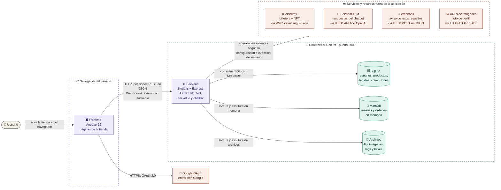
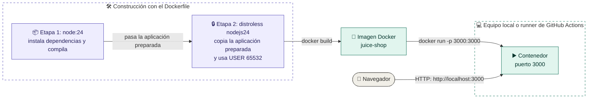

# Arquitectura de OWASP Juice Shop

OWASP Juice Shop es una tienda en línea de jugos, hecha a propósito con vulnerabilidades para practicar seguridad. Esta sección describe sus componentes, cómo se conectan y cómo se despliega. La información se tomó del código del repositorio.

## 1. Vista general

**Colores:** morado = código de la aplicación, verde = datos dentro del contenedor, naranja = servicios externos. Los recuadros punteados indican dónde se ejecuta cada parte.

## 2. Componentes

| Componente | Qué es | Qué hace | Dónde se encuentra |
|---|---|---|---|
| 🖥️ Frontend | Aplicación web hecha con Angular | Es la tienda que ve el usuario en el navegador: productos, carrito e inicio de sesión | `frontend/` |
| ⚙️ Backend | Servidor hecho con Node.js y Express | Recibe las peticiones del frontend, aplica la lógica de la tienda y responde | `server.ts`, `routes/` |
| API REST | Rutas `/rest` y `/api` del backend | Son las direcciones a las que llama el frontend para iniciar sesión, ver productos, pagar o hacer pedidos | `server.ts` |
| Sesión | Token JWT | Identifica al usuario después de iniciar sesión | `lib/insecurity.ts` |
| Notificaciones | socket.io | Envía avisos al navegador en tiempo real | `lib/startup/` |
| Chatbot | Asistente "Juicy" | Responde preguntas de los clientes con ayuda de un servidor LLM configurado | `routes/chat.ts` |
| 🗄️ SQLite | Base de datos principal | Guarda usuarios, productos, canastas, tarjetas y direcciones | `models/`, `data/` |
| 📝 MarsDB | Base de datos en memoria | Guarda reseñas y órdenes; se borra al reiniciar la aplicación | `data/mongodb.ts` |
| 📁 Archivos | Carpetas dentro del contenedor | Guardan archivos públicos, imágenes subidas, registros de acceso y llaves | `ftp/`, `logs/`, `encryptionkeys/` |

## 3. Servicios externos

La tienda funciona sin ellos; solo se usan para funciones específicas.

| Servicio | Para qué se usa |
|---|---|
| 🔑 Google OAuth | Iniciar sesión con una cuenta de Google. Necesita una URL de redirección autorizada |
| ⛓️ Alchemy | Conectarse a una red de criptomonedas para los retos de billetera y NFT |
| 🤖 Servidor LLM | Generar las respuestas del chatbot. Puede estar en el equipo local o en otro servidor |
| 📣 Webhook | Avisar a otro sistema cuando alguien resuelve un reto |
| 🖼️ URLs de imágenes | Descargar una imagen de internet como foto de perfil de un usuario con sesión iniciada |

## 4. Cómo se conectan

| Desde | Hacia | Por medio de | Qué se envía |
|---|---|---|---|
| Usuario | Frontend | El navegador, en `http://localhost:3000` | El usuario abre la tienda |
| Backend | Navegador | HTTP | Los archivos HTML, CSS y JavaScript del frontend |
| Frontend | Backend | HTTP con peticiones REST en formato JSON | Datos de inicio de sesión, búsquedas, productos, canasta, pagos, direcciones y reseñas. Cuando hay un token guardado, el frontend lo agrega a las peticiones HTTP |
| Backend | Frontend | WebSocket con socket.io | Avisos en tiempo real, por ejemplo cuando se resuelve un reto |
| Frontend | Google OAuth | HTTPS con el protocolo OAuth 2.0 | El usuario inicia sesión en Google y Google devuelve un token para identificarlo |
| Backend | SQLite | Consultas SQL por medio de Sequelize | Lectura y escritura de usuarios, productos, canastas, tarjetas y direcciones |
| Backend | MarsDB | Lectura y escritura en memoria | Reseñas de productos y órdenes |
| Backend | Archivos | Lectura y escritura dentro del contenedor | Imágenes subidas, archivos públicos, registros de acceso y llaves |
| Backend | Alchemy | WebSocket seguro (wss) | Consultas a la red de criptomonedas para los retos de billetera y NFT |
| Backend | Servidor LLM | HTTP con una API compatible con OpenAI | La pregunta del usuario al chatbot; el servidor devuelve la respuesta |
| Backend | Webhook | HTTP POST con datos en JSON | Aviso de que se resolvió un reto |
| Backend | URLs de imágenes | HTTP/HTTPS GET | Descarga la imagen que el usuario eligió como foto de perfil |

**Ejemplo: inicio de sesión**

1. El usuario escribe su correo y contraseña en el frontend.
2. El frontend los envía al backend con una petición `POST /rest/user/login`.
3. El backend busca al usuario en SQLite y comprueba las credenciales. Si el usuario tiene segundo factor, le pide completarlo.
4. Si todo es correcto, el backend genera un token JWT y lo devuelve.
5. El frontend guarda el token y, mientras esté guardado, lo agrega a las siguientes peticiones, así el backend sabe qué usuario las hace.

## 5. Despliegue

La aplicación se construye con el `Dockerfile` en dos etapas. En la primera se instalan las dependencias y se compila la aplicación. En la segunda se copia la aplicación preparada a una imagen mínima (distroless), que se ejecuta sin permisos de administrador en el puerto 3000.

Las bases de datos y los archivos viven dentro del mismo contenedor, por lo que no hay servidores de base de datos separados. En este proyecto la aplicación se ejecuta solo en contenedores propios: de forma local y dentro del pipeline de GitHub Actions para el escaneo DAST.

## 6. Principios de seguridad del diseño

Estos principios se usan como referencia para analizar el diseño de Juice Shop y para decidir los controles del proyecto. Como Juice Shop es vulnerable a propósito, en varios casos el principio se cumple solo en parte.

| Principio | Qué significa | Qué se observa en Juice Shop | Cómo se aplicará en el proyecto |
|---|---|---|---|
| Mínimo privilegio | Cada parte tiene solo los permisos que necesita | El contenedor corre sin permisos de administrador. Sin embargo, algunas rutas permiten acciones sin los permisos adecuados, como parte de los retos de control de acceso | El pipeline usará permisos mínimos (`contents: read`) y se definirán requisitos ASVS de control de acceso |
| Defensa en profundidad | Varias capas de protección: si una falla, otra detiene el problema | Tiene algunas capas, como cabeceras de seguridad y un límite de intentos al restablecer la contraseña, pero la aplicación incluye vulnerabilidades intencionales, por lo que estas medidas no garantizan su seguridad | El pipeline revisará el código (SAST), las dependencias (SCA), la imagen y la infraestructura (Trivy, Checkov) y la aplicación en ejecución (ZAP), y bloqueará cuando se supere un umbral |
| Validación de entradas | No confiar en lo que envía el usuario | Contiene fallas intencionales en algunos controles, como la consulta SQL del login y la descarga de imágenes desde cualquier URL | Se definirán requisitos ASVS de validación, y la herramienta SAST seleccionada y ZAP buscarán este tipo de fallas |
| Reducir la superficie de ataque | Exponer solo lo necesario | La imagen distroless no incluye herramientas extra, pero la aplicación permite listar carpetas como `/ftp`, `/encryptionkeys` y `/support/logs` | Se escanearán el Dockerfile y la imagen, y las rutas expuestas se analizarán en el modelo de amenazas |
| Proteger los datos sensibles | Guardar y enviar la información sensible de forma segura | Las contraseñas se guardan con MD5, un método débil, y la llave que firma los tokens está escrita en el código | Se clasificarán los datos por sensibilidad, se definirán requisitos ASVS de criptografía y ningún secreto real se guardará en el repositorio |
