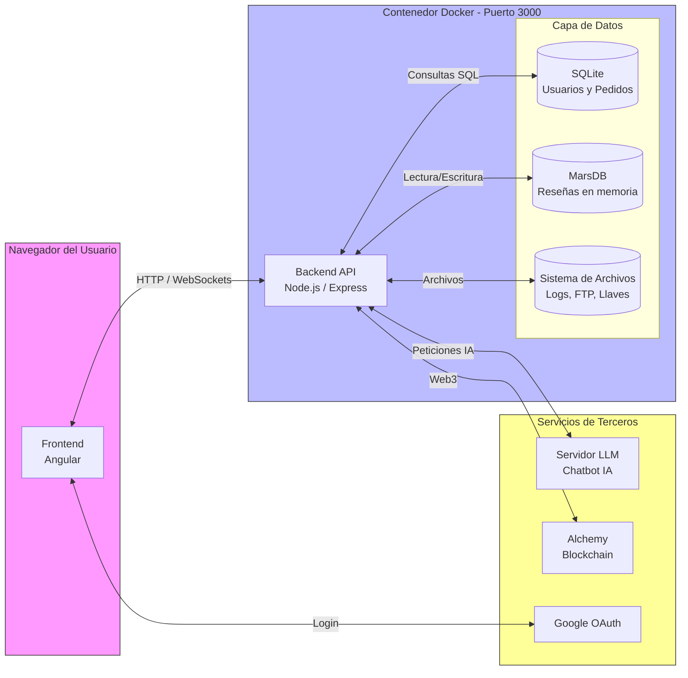

# Arquitectura de la Aplicación

**Proyecto:** OWASP Juice Shop - Ciclo de Desarrollo Seguro (SSDLC)
**Autoras:** Gabriela Navarro y Sandra Soria
**Fecha:** Noviembre 2026
**Versión:** 1.0
**Fase:** Fase 1 - Diseño de la Aplicación

---

OWASP Juice Shop es una aplicación web moderna construida bajo una arquitectura cliente-servidor (Monolito). A continuación se detallan sus componentes principales y cómo se comunican.

## Diagrama de Componentes

| Componente | Tecnología | Función |
| :--- | :--- | :--- |
| **Frontend** | Angular (TypeScript) | Interfaz gráfica (SPA) que el usuario ve en el navegador. Se comunica con el backend vía API REST. |
| **Backend** | Node.js + Express | Procesa la lógica de negocio, valida sesiones (JWT) y atiende las peticiones de la API. |
| **Base de Datos Relacional** | SQLite | Guarda datos persistentes: usuarios, contraseñas hasheadas, productos y tarjetas. |
| **Base de Datos en Memoria** | MarsDB | Guarda datos temporales (reseñas, carritos) que se pierden al reiniciar el servidor. |
| **Servicios Externos**| Varios | Google (Login), Alchemy (Cripto), LLM (Chatbot). Representan riesgos al estar fuera del control del equipo. |