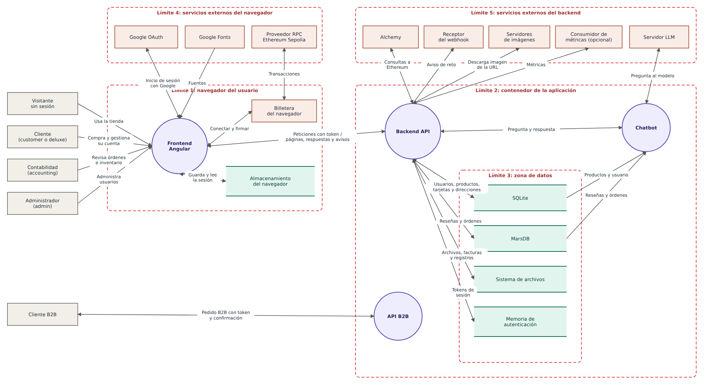

# Diagrama de flujo de datos (DFD) de OWASP Juice Shop

El DFD muestra quién usa la aplicación, qué partes procesan los datos, dónde se guardan, por dónde viajan y en qué puntos cambia el nivel de confianza. Se construyó a partir del código del repositorio y del DFD que trae el proyecto original en `threat-model.json`, al que se agregaron los servicios externos, el chatbot, el almacenamiento del navegador, la memoria de autenticación y nombres para los límites de confianza.

El diagrama se hizo en OWASP Threat Dragon y su archivo está en `security/threat-model/juice-shop.json`. El mismo modelo se usa en la Fase 2 para identificar las amenazas con STRIDE.

**Cómo se lee:**
- Rectángulos grises: usuarios de la tienda.
- Rectángulos naranjas: servicios externos.
- Círculos morados: procesos, es decir, las partes que procesan datos.
- Bloques verdes con dos líneas: almacenes de datos.
- Recuadros rojos punteados: límites de confianza.
- Cada flecha indica qué datos viajan; si tiene punta en los dos extremos, los datos van y vienen.

## Actores

| Actor | Descripción |
|---|---|
| Visitante sin sesión | Persona que navega la tienda sin iniciar sesión: ve productos, busca y se registra |
| Cliente (customer o deluxe) | Usuario registrado que compra, guarda direcciones y tarjetas, escribe reseñas y usa el chatbot |
| Contabilidad (accounting) | Usuario con permisos para ver todas las órdenes y administrar el inventario |
| Administrador (admin) | Usuario con permisos para gestionar usuarios y la tienda |
| Cliente B2B | Empresa que envía pedidos directamente a la API B2B |
| Google OAuth | Servicio para iniciar sesión con una cuenta de Google |
| Google Fonts | Servicio del que el navegador descarga las fuentes de la página |
| Billetera del navegador | Extensión del navegador para criptomonedas, como MetaMask |
| Proveedor RPC Ethereum Sepolia | Servicio público que usa la billetera para conectarse a la red de prueba de Ethereum |
| Alchemy | Servicio que usa el backend para conectarse a la red de Ethereum |
| Servidor LLM | Modelo de lenguaje que genera las respuestas del chatbot |
| Receptor del webhook | Sistema que recibe un aviso cuando se resuelve un reto |
| Servidores de imágenes | Sitios de internet de los que el backend descarga imágenes de perfil |
| Consumidor de métricas (opcional) | Sistema de monitoreo, como Prometheus, que lee las métricas de la aplicación |

## Procesos

| Proceso | Qué hace |
|---|---|
| Frontend Angular | Muestra la tienda en el navegador y envía las acciones del usuario al backend |
| Backend API | Atiende las rutas `/rest` y `/api`, aplica la lógica de la tienda y accede a los datos |
| API B2B | Recibe pedidos de empresas en `/b2b/v2/orders`, valida el JWT del cliente, evalúa el pedido y devuelve una confirmación sin guardarlo |
| Chatbot | Recibe preguntas, consulta datos de la tienda y pide la respuesta al servidor LLM, que se devuelve de forma progresiva |

El backend, la API B2B y el chatbot forman parte del mismo servidor Node.js y Express; se separan en el diagrama porque cada uno maneja datos distintos.

## Almacenes de datos

| Almacén | Qué guarda |
|---|---|
| Almacenamiento del navegador | El token de sesión JWT (en `localStorage` y en una cookie), el identificador de la canasta (`sessionStorage`), el correo del usuario y las conversaciones del chatbot |
| SQLite | Usuarios y contraseñas (en hash), productos, canastas, tarjetas, direcciones y billeteras |
| MarsDB | Reseñas de productos y órdenes |
| Sistema de archivos | Facturas PDF y archivos públicos (`ftp/`), imágenes subidas, registros de acceso (`logs/`), llaves (`encryptionkeys/`) y configuración |
| Memoria de autenticación | Los tokens y datos de los usuarios con sesión iniciada, guardados en la memoria del backend |

## Flujos de datos

| Desde | Hacia | Qué viaja | ¿Cruza un límite? |
|---|---|---|---|
| Usuarios | Frontend | Acciones en la tienda: credenciales, búsquedas, datos de pago y dirección, reseñas y archivos | Sí, entra al navegador |
| Frontend | Backend | Peticiones REST en JSON con el token de sesión cuando hay uno guardado; el backend devuelve los archivos del frontend, respuestas, facturas y avisos por WebSocket | Sí, navegador ↔ contenedor |
| Frontend | Almacenamiento del navegador | Token de sesión, identificador de la canasta, correo y conversaciones del chatbot | No |
| Frontend | Google OAuth | Inicio de sesión con Google; Google devuelve un token de acceso y el correo del usuario | Sí, navegador ↔ terceros |
| Google Fonts | Frontend | Fuentes de la página | Sí, terceros → navegador |
| Frontend | Billetera del navegador | Solicitud de conexión y firma; la billetera devuelve la dirección del usuario | No |
| Billetera del navegador | Proveedor RPC | Transacciones y consultas a la red Ethereum Sepolia | Sí, navegador ↔ terceros |
| Cliente B2B | API B2B | JWT y pedido en JSON; la API devuelve una confirmación con número de orden y fecha de pago | Sí, entra al contenedor |
| Backend | SQLite | Lectura y escritura de usuarios, productos, canastas, tarjetas, direcciones y billeteras | Sí, contenedor ↔ zona de datos |
| Backend | MarsDB | Lectura y escritura de reseñas y órdenes | Sí, contenedor ↔ zona de datos |
| Backend | Sistema de archivos | Imágenes subidas, facturas PDF, registros de acceso, configuración y llaves | Sí, contenedor ↔ zona de datos |
| Backend | Memoria de autenticación | Tokens de los usuarios con sesión iniciada | Sí, contenedor ↔ zona de datos |
| Backend | Chatbot | Pregunta del usuario; el chatbot devuelve la respuesta de forma progresiva | No |
| SQLite y MarsDB | Chatbot | Productos, nombre y correo del usuario, reseñas y órdenes | Sí, zona de datos → contenedor |
| Chatbot | Servidor LLM | Pregunta y contexto; el servidor devuelve la respuesta generada | Sí, contenedor ↔ terceros |
| Backend | Alchemy | Consultas a la red Ethereum para los retos de billetera y NFT | Sí, contenedor ↔ terceros |
| Backend | Receptor del webhook | Aviso de reto resuelto en JSON | Sí, contenedor → terceros |
| Backend | Servidores de imágenes | Petición GET a la URL que indica el usuario; el servidor devuelve la imagen | Sí, contenedor ↔ terceros |
| Consumidor de métricas | Backend | Petición a `/metrics`; el backend devuelve las métricas de la aplicación | Sí, terceros ↔ contenedor |

## Límites de confianza

| Límite | Qué contiene | Por qué es un límite |
|---|---|---|
| Límite 1: navegador del usuario | Frontend, almacenamiento del navegador y billetera | Lo controla el usuario: puede modificar las peticiones o leer el token, por eso el servidor no debe confiar en lo que llega desde aquí |
| Límite 2: contenedor de la aplicación | Backend, API B2B y chatbot | Es el código del servidor; aquí se deben validar las entradas y aplicar la autenticación y el control de acceso |
| Límite 3: zona de datos | SQLite, MarsDB, sistema de archivos y memoria de autenticación | Contiene la información sensible; solo los procesos del backend deberían acceder a ella |
| Límite 4: servicios externos del navegador | Google OAuth, Google Fonts y proveedor RPC | Son servicios fuera del control del equipo; el navegador recibe datos de ellos |
| Límite 5: servicios externos del backend | Alchemy, servidor LLM, receptor del webhook, servidores de imágenes y consumidor de métricas | Son servicios fuera del control del equipo; el backend les envía datos y recibe respuestas que no son confiables |

Los flujos que cruzan un límite de confianza son los puntos donde se analizarán las amenazas con STRIDE en la Fase 2.
