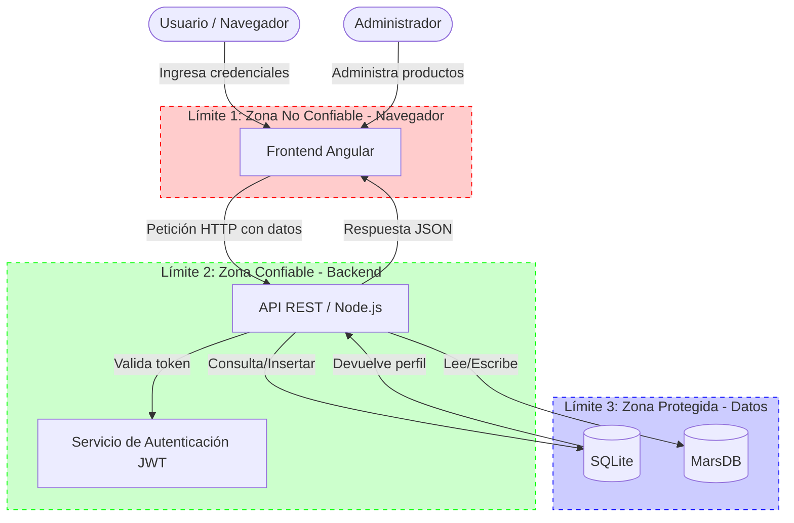

# Diagrama de Flujo de Datos (DFD) y Límites de Confianza

Este DFD de Nivel 1 ilustra cómo fluye la información desde el usuario hasta los almacenes de datos, identificando las fronteras donde la confianza cambia (Trust Boundaries). Los datos que cruzan un límite de confianza son los puntos de mayor riesgo y donde se enfocará el análisis STRIDE.

## DFD con Límites de Confianza

| Origen | Destino | Dato que viaja | Amenaza potencial (STRIDE) |
| :--- | :--- | :--- | :--- |
| Usuario | Frontend | Credenciales (Email/Pass) | **Spoofing:** Robo de credenciales si no hay HTTPS. |
| Frontend | API REST | Petición HTTP (JSON) | **Tampering:** Modificar el JSON para inyectar SQL o cambiar precios. |
| API REST | SQLite | Consulta SQL | **Information Disclosure:** Si la consulta no está parametrizada, un atacante puede leer toda la base de datos. |
| API REST | Frontend | Respuesta JSON (Perfil) | **XSS:** Si el nombre del usuario se devuelve sin escapar, se ejecuta código malicioso en el navegador. |
| Usuario (Normal) | API REST | Petición a ruta de Admin | **Elevation of Privilege:** Saltarse el frontend y llamar directo a la API para hacerse admin. |